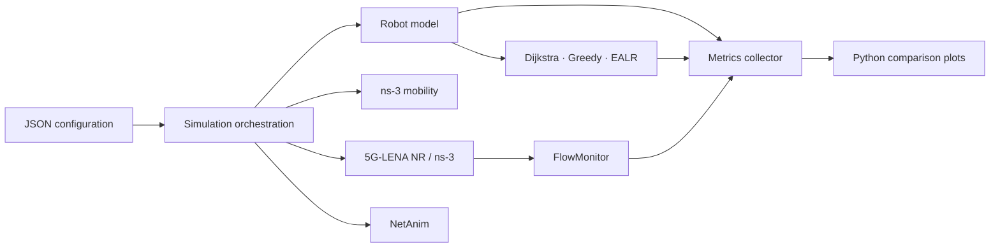

# Private 5G Energy-Aware Routing

Private 5G Energy-Aware Routing (EALR) is a modular C++ research framework for evaluating multi-hop routing decisions among industrial robots on a private 5G factory floor. It compares a distance-only Dijkstra baseline, geographic Greedy routing, and EALR—an energy- and congestion-aware shortest-path algorithm.

The project is structured for reproducible experiments: JSON scenarios define a run, CMake manages the native build, ns-3 provides mobility and NetAnim integration, and Python produces one comparison chart per metric.

## Motivation

Industrial robots must exchange data with low latency while operating on constrained batteries and potentially congested wireless links. A route that is geographically short can still be undesirable if it repeatedly selects a low-battery relay or a robot with a growing packet queue. EALR makes these trade-offs explicit and comparable against simpler baselines.

## What is implemented

- Validated, typed JSON experiment configuration with relative scenario inheritance.
- Robot domain model: position, battery, queue length, neighbour set, and routing eligibility.
- Dijkstra, Greedy, and EALR routing implementations behind a common interface.
- EALR cost model with configurable distance, battery, and congestion weights.
- Metrics collector with CSV and summary exports, plus an ns-3 FlowMonitor adapter.
- ns-3 factory-floor scenario runner with static, grid, and random-waypoint mobility.
- Conditional 5G-LENA NR gNB/UE setup when the discovered ns-3 build exports `ns3::nr`.
- NetAnim XML, robot-state colours, packet metadata, and return-to-charge animation support.
- Python comparison plotting for latency, throughput, battery, delivery ratio, loss, network lifetime, and charging events.

## Architecture



Module ownership is deliberately separated: configuration does not contain routing logic; routing does not parse JSON; metrics does not own mobility; and visualization does not make energy decisions. See [the architecture guide](docs/architecture.md).

## Repository layout

| Path | Purpose |
| --- | --- |
| `configs/` | Reproducible JSON experiment configurations. |
| `include/ealr/` | Public C++ interfaces. |
| `src/config/` | JSON loading, inheritance, and validation. |
| `src/robot/` | Robot state, battery thresholds, neighbours, and queues. |
| `src/routing/` | Routing contract plus Dijkstra, Greedy, and EALR. |
| `src/metrics/` | Framework metrics and ns-3 FlowMonitor adapter. |
| `src/simulation/` | ns-3 and optional 5G-LENA scenario setup. |
| `src/visualization/` | NetAnim presentation support. |
| `scripts/` | Python plotting utility and its requirements. |
| `tests/` | CTest, ns-3, and Python regression tests. |
| `results/` | Timestamped experiment output (ignored by Git). |
| `docs/` | Detailed component documentation. |

## Dependencies

Required for the core framework:

- CMake 3.22 or newer
- C++17 compiler
- Boost.JSON CMake package (`boost_json`)

Required for ns-3 scenarios:

- ns-3 with `core`, `network`, `mobility`, `netanim`, and FlowMonitor modules
- An MPI C++ toolchain when required by the installed ns-3 package
- C++20 compiler support for ns-3 3.46 public headers

Required for real 5G-LENA NR device installation:

- An ns-3/5G-LENA build exporting the `ns3::nr` CMake target

Required for comparison charts:

- Python 3.10 or newer
- Packages in [`scripts/requirements.txt`](scripts/requirements.txt)

The CMake configuration reports ns-3 and 5G-LENA availability separately. A standard ns-3 installation can build mobility and NetAnim support, but only an installation exposing `ns3::nr` enables NR UE/gNB device setup.

## Build and test

### Core-only bootstrap

Use this preset when ns-3 is not installed or when working only on configuration, routing, robot, and metrics code.

```sh
cmake --preset bootstrap
cmake --build --preset bootstrap
ctest --preset bootstrap
```

### ns-3 development build

Make the ns-3 CMake package discoverable through `CMAKE_PREFIX_PATH` if it is not installed in a standard prefix.

```sh
cmake --preset default
cmake --build --preset default
ctest --preset default
```

The `default` build creates `ealr-ns3-scenario` when the required ns-3 targets are present.

## Run an ns-3 scenario

The current ns-3 runner creates robot and gNB nodes, installs configured mobility, produces NetAnim XML, and installs 5G-LENA NR devices when supported by the build.

```sh
./build/default/ealr-ns3-scenario \
  --config configs/baseline.json \
  --animation results/baseline/animation.xml
```

Open the generated XML with NetAnim to inspect node positions, labels, and state colours. The runner reports whether NR devices were installed. See [ns-3 and 5G-LENA integration](docs/ns3-integration.md) and [NetAnim](docs/netanim.md).

## Configuration

Every scenario is JSON. The supplied configurations are:

| Scenario | Purpose |
| --- | --- |
| `baseline.json` | Grid deployment with Dijkstra routing. |
| `low_battery.json` | EALR weights and constrained starting battery. |
| `dense_network.json` | Higher robot density and shorter communication radius. |
| `high_traffic.json` | Increased packet rate and size. |
| `factory_layout.json` | Static factory layout. |
| `random_layout.json` | Random-waypoint factory layout. |

Derived scenarios use relative inheritance:

```json
{
  "extends": "baseline.json",
  "routing": {
    "algorithm": "ealr",
    "alpha": 1.0,
    "beta": 2.0,
    "gamma": 1.0
  }
}
```

The loader deep-merges nested objects, rejects circular inheritance, validates unknown properties, and emits `ConfigurationError` messages that identify the failing field. Top-level sections are `simulation`, `routing`, `battery`, `traffic`, `mobility`, `robots`, `chargingStation`, `metrics`, `private5g`, and `output`. See [the configuration guide](docs/configuration.md).

The warehouse deployment plan is maintained separately in [`configs/warehouse_leaf_spine.json`](configs/warehouse_leaf_spine.json). It models the fixed-endpoint leaf–spine network rather than the legacy multi-hop robot experiment, and keeps safety thresholds and QoS latency targets configurable.

## Routing algorithms

| Algorithm | Decision rule | Cost |
| --- | --- | --- |
| Dijkstra | Globally shortest route over permitted neighbour links. | Euclidean distance only. |
| Greedy | At each hop, choose the unvisited eligible neighbour closest to the destination. | Local geographic distance to destination. |
| EALR | Shortest path using energy and congestion awareness. | `alpha × distance + beta × batteryPenalty + gamma × congestionPenalty` |

For EALR, `batteryPenalty = (100 - remainingBatteryPercent) / 100` and congestion penalty is the candidate forwarding robot’s queue length. Low-battery robots remain routable but become less attractive; robots in `ReturningToCharge` are never selected as source, destination, or relay. See [the routing guide](docs/routing.md).

## Battery and robot states

The robot model validates battery thresholds and supports the following states:

- `Idle` and `Working`: normal operation; shown in green in NetAnim.
- `LowBattery`: entered at or below `lowBatteryThreshold`; still routable; shown in yellow.
- `ReturningToCharge`: entered at or below `criticalBatteryThreshold`; permanently removed from routing; shown in red and can be animated toward the charging station.

Battery consumption is monotonic in the robot model. The energy subsystem supplies the configured transmit, receive, relay, and idle costs when traffic orchestration is added.

## Metrics and FlowMonitor

`MetricsCollector` records and exports:

- Average end-to-end delay
- Throughput
- Packet delivery ratio and packet loss
- Average and minimum battery remaining
- Charging events
- Robots removed from routing
- Network lifetime
- Route recomputations

Use `writeCsv()` for the standard `metric,value` file and `writeSummary()` for a readable report. In ns-3 traffic scenarios, call `Ns3FlowMonitorCollector::collect()` after `Simulator::Run()` and before `Simulator::Destroy()` to import FlowMonitor counters. See [the metrics guide](docs/metrics.md).

## NetAnim

`NetAnimVisualization` writes packet metadata and assigns labels and state colours to robot and gNB nodes. When a robot transitions to `ReturningToCharge`, update its visual state and schedule `animateReturnToCharge()` with the configured charging-station position. See [the NetAnim guide](docs/netanim.md).

## Generate comparison plots

Install the plotting dependency:

```sh
python3 -m pip install -r scripts/requirements.txt
```

Pass one experiment directory per algorithm. The script reads each directory’s `metrics.csv` and uses `routing.algorithm` from `config.json` as its label when available.

```sh
python3 scripts/plot_results.py \
  --input results/dijkstra-run \
  --input results/greedy-run \
  --input results/ealr-run \
  --output-dir results/comparison-graphs
```

Each metric is rendered as its own PNG chart. Use `--format pdf` or `--label` when needed. See [the plotting guide](docs/plotting.md).

## Standard experiment artifacts

The intended timestamped experiment directory is:

```text
results/
└── 2026-07-26_18-45-00/
    ├── config.json
    ├── summary.txt
    ├── metrics.csv
    ├── animation.xml
    ├── simulation.log
    ├── routing.log
    └── graphs/
        ├── latency-comparison.png
        ├── throughput-comparison.png
        └── ...
```

The current components already create the underlying NetAnim, metrics, and plotting artifacts. Timestamped-folder creation and one-command assembly are the remaining orchestration work described below.

## Current integration boundary

The framework components are implemented and tested independently. The next orchestration step is to connect configured packet traffic, battery-cost events, custom multi-hop forwarding, FlowMonitor collection, and timestamped result-folder assembly into one end-to-end experiment command. Until then, use the individual scenario, metrics, NetAnim, and plotting entry points documented above.

## Future extensions

The module boundaries support future work without changing the routing contract:

- Obstacle-aware factory topology and radio propagation
- Dynamic factory environments and task-aware mobility
- Charging schedule optimisation
- Additional routing algorithms
- Multiple gNBs, network slicing, and QoS flows
- Security and resilience modules

## Contributing

Keep new responsibilities within their module boundary, add CTest coverage, and preserve JSON-driven experiment parameters. New routing algorithms should implement `RoutingAlgorithm` and operate only on `RoutingTopology` snapshots. Run both presets before submitting changes:

```sh
cmake --build --preset default && ctest --preset default
cmake --build --preset bootstrap && ctest --preset bootstrap
```
